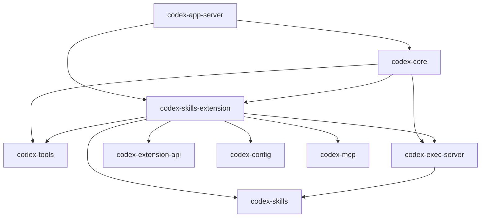

# Incremental migration to Microsoft Agent Framework (.NET)

## Scope and baseline

- Work in the existing Codex repository, not a replacement application.
- Migration branch: `migration/maf-dotnet`.
- Analysis baseline: `6326163b9a` (`Send incremental tool catalog updates in Responses Lite (#50540)`).
- Target runtime: Microsoft Agent Framework (MAF), .NET.
- The goal is to replace the Codex Agent loop with MAF, not retain the Rust Agent loop with a MAF plugin. The [Agent replacement stages](maf-agent-runtime-stages.md) define the current implementation order and acceptance gates.
- Preserve existing tools, skill content, execution controls, clients, and stored conversations while replacing individual implementations.
- Phase 2 includes a host-only skill snapshot adapter. Stage 3A adds MAF-owned iteration; stage 3B connects an explicitly selected TUI/app-server session to a real .NET process and Azure Foundry. The default Rust backend remains unchanged. General tools and script execution are not enabled in the MAF pilot.

## Verified toolchain and analysis tools

Verified on Ubuntu 24.04 x86-64 during this migration investigation:

| Tool | Verified version | Purpose |
| --- | --- | --- |
| Rust / Cargo | 1.95.0 / 1.95.0 | Repository-pinned compiler and workspace dependency analysis |
| Rust components | rustfmt, clippy, rust-src, rust-analyzer for 1.95.0 | Formatting, linting, standard-library sources, semantic analysis |
| .NET SDK / runtime | 10.0.401 / 10.0.12 | Existing user installation, restored to PATH |
| ripgrep | 14.1.0 | Fast source and symbol-text search |
| GCC | 13.3.0 | Native dependencies and linker support |
| CMake / protoc | 3.28.3 / 3.21.12 | Native and protobuf build dependencies |
| OpenSSL via pkg-config | 3.0.13 | Native TLS dependency discovery |
| just / DotSlash | 1.58.0 / 0.5.7 | Repository task entry point and pinned development tools |
| cargo-nextest | 0.9.146 | Focused test execution through the existing justfile |
| VS Code Rust extension | rust-lang.rust-analyzer 0.3.3057 | Working semantic references and implementations |
| VS Code C# extension | ms-dotnettools.csharp 2.160.4 | .NET editor tooling; API compatibility was checked by actual compilation |

The Rust reference provider returned 183 usages for `ToolExecutor`, including implementations in Core and extension crates. This is a symbol-reference result, not a complete dynamic call graph.

Installed system packages include `build-essential`, `pkg-config`, `libssl-dev`, `cmake`, `clang`, `ripgrep`, and `protobuf-compiler`. Rustup installed the pinned toolchain and its components. Existing .NET binaries were reused, not downloaded again. Rustup configured the user shell; .NET PATH and `DOTNET_ROOT` were added to the user login and interactive Bash configurations.

Bazel and Node were not installed: this investigation uses the repository's supported Cargo path and does not build the JS SDK, run the full repository formatter, or validate Bazel targets. Installing the tools above does not imply a full CLI/TUI build or all-platform sandbox verification.

Reproduce the relevant analysis from the repository root:

```sh
cargo metadata --manifest-path codex-rs/Cargo.toml --format-version 1 --no-deps --locked
cargo tree --manifest-path codex-rs/Cargo.toml --locked -p codex-skills-extension --depth 1 --edges normal
CARGO_BUILD_JOBS=2 just test --locked -p codex-skills --lib
CARGO_BUILD_JOBS=2 just test --locked -p codex-skills-extension -p codex-tools --lib
dotnet run --file scripts/maf_api_probe.cs
```

Use `rg` for initial routing, rust-analyzer references for ownership/call-site checks, Cargo metadata/tree for package dependencies, and focused nextest runs for behavior. No separate application or replacement framework is required for these checks.

## Verified MAF package surface

The [reproducible probe](../scripts/maf_api_probe.cs) restores fixed versions of `Microsoft.Agents.AI` and `Microsoft.Agents.AI.Harness`, both **1.23.0**, using .NET 10 file-based execution. It is an analysis utility, not the future Agent host. NativeAOT is disabled because the probe inspects public methods with reflection.

Compilation and execution verified:

- `AIAgent`, `AgentSession`, and the asynchronous session serialization methods.
- `AgentSkillsProvider`, `AgentFileSkillsSource`, and `AgentSkillsProviderBuilder` in the core package.
- `HarnessAgent` through the separate Harness package.
- `AgentFileSkillsSource.GetSkillsAsync(AgentSkillsSourceContext, CancellationToken)`.
- Builder methods named `UseFileSkills` and `UseSkills` in this version; do not assume the singular names shown in some documentation examples.

NuGet exact-match search did not return a `Microsoft.Agents.AI.Skills` package. Do not add a guessed package dependency. The probe performs no model inference, file-skill discovery, skill-script execution, or Codex/MAF session conversion; those integrations still need their own tests.

## Dependency evidence

Cargo metadata reported **161 workspace packages**. The initial metadata inventory included normal and development path dependencies; the focused `cargo tree --edges normal` check distinguishes runtime dependencies for the skills extension.

Selected direct normal dependency edges, checked against Cargo manifests and the focused tree:



The skills extension also directly depends on analytics, telemetry, protocol, and path/plugin helpers. A standalone MAF file loader cannot replace all of this responsibility. `codex-tools` likewise contains Responses API adaptations and native Rust execution contracts, not a framework-neutral binary plugin SDK.

## Existing architecture and replacement constraints

| Surface | Source evidence | Migration implication |
| --- | --- | --- |
| Client transport | [app-server](../codex-rs/app-server/src/lib.rs) | Retain the client-facing protocol while moving internals. This does not prove all clients can switch to an external server without changes. |
| Commands and events | [protocol](../codex-rs/protocol/src/protocol.rs) | Preserve command ordering, event identity, approval replies, interruption, and completion behavior. |
| Turn execution | [run_turn](../codex-rs/core/src/session/turn.rs) | The model/tool loop is coupled to context, events, hooks, and persistence. Replacing only the model HTTP client would not make MAF the agent runtime. |
| Shared tool contracts | [codex-tools](../codex-rs/tools/README.md) | Definitions and executable contracts are partially extracted; orchestration is deliberately not fully extracted. |
| Tool dispatch | [registry](../codex-rs/core/src/tools/registry.rs), [router](../codex-rs/core/src/tools/router.rs) | Preserve advertised schemas, executable implementations, discovery, and output behavior together. |
| Extension adapter | [ExtensionToolAdapter](../codex-rs/core/src/tools/handlers/extension_tools.rs) | This is an in-process Rust trait adapter with borrowed context, not an existing .NET plugin ABI or RPC service. |
| Execution policy | [ToolOrchestrator](../codex-rs/core/src/tools/orchestrator.rs) | Keep approvals, sandbox policy, and escalation semantics authoritative during coexistence. |
| Skill metadata | [skills](../codex-rs/skills/src/lib.rs), [catalog rendering](../codex-rs/ext/skills/src/render.rs) | Existing scopes, ordering, aliases, truncation, and context budgets need characterization before replacing discovery or rendering. |
| Host discovery | [HostSkillsService](../codex-rs/ext/skills/src/host_service.rs), [HostSkillProvider](../codex-rs/ext/skills/src/provider/host.rs) | Discovery/cache ownership belongs to the service. The provider only maps its immutable snapshot into the catalog/read contract. |
| Skill source injection | [SkillProvider](../codex-rs/ext/skills/src/provider.rs), [SkillProviders](../codex-rs/ext/skills/src/sources.rs), [installation](../codex-rs/ext/skills/src/extension.rs) | A real Rust injection boundary exists, but borrowed filesystem/MCP context still requires an explicit cross-process adaptation. |
| Execution service | [exec-server](../codex-rs/exec-server/README.md), [wire protocol](../codex-rs/exec-server-protocol/src/protocol.rs) | Reusable process/filesystem RPC boundary, but not a complete RPC facade for the Core tool registry or approval flow. |
| Storage | [ThreadStore](../codex-rs/thread-store/src/store.rs) | Keep historical data authoritative; MAF session serialization is not a drop-in replacement for Codex history. |

Current logical execution path:

```text
client input
  -> app-server / command handling
  -> Core session and turn execution
  -> model-visible tool catalog and tool dispatch
  -> existing handlers / approval and execution controls
  -> local or remote execution and external services
  -> tool results, persisted history, and client events
```

This is a logical path, not a claim that every tool uses the same sandbox orchestration implementation.

## Coexistence design

Keep Codex as the host during early migration. Introduce only the .NET process and narrow adapter required by the selected replacement; do not create a second UI, workspace manager, tool suite, or persistence system.

```text
Existing Codex clients and host
  -> existing Rust Agent (default)
  -> selected .NET MAF Agent (experimental TUI/app-server pilot)
     -> model transport and authorized Rust capabilities

Existing Rust policy, tool execution, and persistence remain authoritative.
```

The phase-2 interprocess contract carries request identity, bounded results, errors, and a protocol version. Its cancellation behavior is terminal: on a deadline or host disconnect, discard the process/channel rather than reuse it for another request. Pass only the data required by that boundary, never serialize a Rust Session or TurnContext wholesale. Keep host-supplied identity and permissions separate from model-supplied arguments.

The existing exec-server protocol can later support a .NET execution client. It already defines initialization, process control, output events, and filesystem operations. Such a client must preserve the initialization handshake, session-scoped process IDs, URI paths, base64 byte encoding, capability checks, and applicable sandbox contexts. Connecting to exec-server alone does not preserve Core's approval policy.

## Skill loading path and compatibility findings

The [app-server extension composition](../codex-rs/app-server/src/extensions.rs) registers executor and host providers through `install_with_providers_and_metrics`. The [CLI entry point](../codex-rs/cli/src/main.rs) also contains an `install` path. A migration switch must account for both composition paths rather than assuming one global registration point.

Host skill flow:

```text
HostSkillsService: discovery, configuration, caching, request snapshots
  -> HostSkillsSnapshot
  -> HostSkillProvider.list / read
  -> SkillProviders source aggregation
  -> SkillsExtension context/input/tool contributors
  -> catalog rendering and source-aware resource reads
```

`SkillProvider` defines `list`, `read`, and `search`. Listing receives resolved roots and optional host/MCP snapshots. Reading receives authority, package, resource identity, and source-specific access. Executor reads borrow an `EnvironmentAccess`; this is not serializable as a JSON path. The host provider currently returns an empty search result, so adding host search during migration would be a separate behavior change.

Replacing `HostSkillProvider` alone would **not** replace discovery or parsing: its input is already a parsed snapshot. Conversely, letting a .NET component rescan arbitrary paths would bypass the existing source-selection and caching decisions. Keep `HostSkillsService` and source authority intact in the first implementation.

The [Codex parser](../codex-rs/skills/src/parser.rs) accepts a missing/blank name using a supplied fallback, normalizes whitespace, checks a 64-character name limit, and requires a nonempty description. It also repairs certain unquoted YAML scalar values. The MAF probe demonstrates stricter constructor validation:

| Input | Codex parser source behavior | MAF 1.23.0 probe |
| --- | --- | --- |
| `valid-skill` | Accepted with a description | Accepted |
| `Legacy_Skill` | No character-class prohibition in this parser | Rejected |
| `skill with spaces` | Whitespace normalized; length accepted | Rejected |
| Description of 1025 characters | No description length cap in this parser | Rejected |

Codex outcomes in this table are source-derived, not a new cross-runtime differential test. Its existing parser tests passed. MAF outcomes are actual probe assertions. Other loading layers can impose additional constraints, so this table is not a claim that every such file is discoverable through every Codex source.

## First candidate: MAF consumption of an existing skill snapshot

Revised hypothesis: a MAF `AgentSkillsSource` can consume a bounded projection of Codex's authoritative skill snapshot while preserving the existing loader, resource access, and executable scripts. Native discovery replacement is deferred until its compatibility cost is known.

The cheapest discriminating check is a read-only adapter test: provide a controlled Codex snapshot, construct the corresponding MAF skill source, and compare identities, visible descriptions, instructions, and resource access. Do not start an inference loop or execute scripts in this test.

Boundary implemented for Host skill catalogs and main prompts only:

1. Rust owns root resolution, enabled/disabled state, authority, snapshot revision, and the original catalog.
2. A narrow process bridge transfers a bounded catalog projection and opaque references to the .NET source.
3. .NET exposes skills through MAF without re-scanning the host filesystem.
4. Resource requests return to the owning Rust provider using the snapshot, authority, package, and resource identities; caller permissions are host supplied.
5. Existing source-specific readers enforce access. No ambient filesystem, raw credentials, or borrowed Rust objects cross the wire.

MAF-visible names may need stable, collision-checked aliases for legacy names. Preserve the original identity and explicit references in the mapping. A bounded discovery description must not overwrite original skill instructions or stored metadata. Do not silently discard incompatible skills, rename their files, or claim byte-for-byte prompt equivalence after normalization. Alias, description-budget, and explicit-invocation behavior need dedicated comparison cases before activation.

Compare:

- Names, descriptions, content, resource paths, and source identity.
- Multiple roots, duplicate names, missing files, and invalid frontmatter.
- Scope and alias behavior after applying the compatibility adapter.
- Visibility and root restrictions; instructions must not grant permissions.
- Catalog ordering and context-budget behavior at the existing rendering boundary.

This refines the initial proposal to replace file discovery first. A common skill file format is not proof of behavioral equivalence, and the snapshot boundary offers a smaller first integration. Reuse the existing extension/provider abstractions rather than adding a parallel skills framework.

Run the explicit stdio pilot/tests with script execution disabled and existing discovery still authoritative. The .NET process now exists separately from the earlier API probe. It is not registered in app-server or CLI startup, and this change adds no runtime configuration switch.

## Replacement sequence and gates

| Stage | Replace or introduce | Keep | Required evidence |
| --- | --- | --- | --- |
| 0-1 | Toolchain, source/dependency analysis, baseline tests | All runtime behavior | Completed for the focused packages and API probe below. |
| 2 | Read-only MAF consumer of Codex skill snapshots and minimal process adapter | Host discovery/cache, catalog identity, scripts, tools, execution, and sessions | Completed: snapshot/body comparison, bounded failures, unchanged defaults. |
| 3A | MAF-owned model/tool loop in an explicit stdio pilot | Existing Rust skill reader and source authority | Completed: actual MAF function iteration and session history using deterministic host model replies; not a live model integration. |
| 3B | MAF backend for selected new text sessions in TUI/app-server | Existing clients, events, history storage, and default Rust backend | Passed: real .NET/Foundry skill iteration, consecutive turns, interruption, persisted backend guard, and original TUI execution. |
| 3C | MAF-facing adapters for selected Codex tools | Existing handlers, approvals, sandbox, and permission decisions | 3C-1 passed: thin text-read adapter, Core tool bridge, offline denial/cancellation tests, and real Foundry/app-server/TUI reads. Write/shell migration remains pending. |
| 3D | .NET-native MAF tools, superseding further Rust tool bridges | Codex behavioral/security contracts; Rust client/host interfaces for now | 3D-1 passed: native .NET reader, Landlock restrictions, comparison tests, and real Foundry/TUI. Full tool/policy parity remains pending. |
| 4 | Production parity: streaming, budgets, context, memory, MCP, and persistence | Compatible historical data and unchanged behavior outside each boundary | Pending: resume compatibility, context limits, credentials, and source isolation. |
| 5 | Remove superseded Rust Agent implementations | Native helpers still required by execution/security | No remaining callers, rollback/data strategy agreed, and focused regression gates pass. |

Stage 3B uses the existing Core thread/task lifecycle as the host and selects MAF before Rust task execution. Stage 3C-1 proved a Rust tool bridge. The user's updated direction is stage 3D: MAF invokes .NET-native tools, not Rust handlers. The current file reader runs in a restricted .NET worker; Rust retains configuration, model/skill transport, events and history, with the old reader kept only as a test oracle. Do not defer Agent-loop replacement until all skills and scripts have been independently migrated.

Keep at most one active owner of each turn. Freeze backend selection for a thread until a tested state-conversion contract exists. Rollback means choosing the old implementation for compatible work, not silently replaying a partly executed task. Shadow comparison is for read-only operations; never execute side-effecting tools twice for comparison.

The .NET-native direction requires replacing Rust tool-execution dependencies as each tool migrates, while preserving the security contract. Proven OS primitives may still be used by .NET; do not claim sandbox, approval, or PTY equivalence solely because a similarly named function exists.

## Verification rules

- Test the touched boundary first, then its immediate integration with the existing host.
- Preserve approval rejection and cancellation behavior, including pending asynchronous operations.
- Never retry an external side effect merely because a bridge response was lost; reconcile the original call using its identity.
- Keep model history, durable business effects, and execution-process state distinct.
- Preserve existing history read/resume compatibility before changing persistence.
- Do not remove the old path until the new path passes its required gate.

## Verification results and remaining work

| Check | Result | What it does not prove |
| --- | --- | --- |
| Cargo metadata with `--locked --no-deps` | Passed; 161 workspace packages | Full dependency resolution or a complete runtime call graph |
| Focused Cargo tree with `--locked --edges normal` | Passed for `codex-skills-extension` | Runtime behavior |
| Rust semantic references | `ToolExecutor` returned 183 usages | Exhaustive dynamic dispatch/control flow |
| `codex-skills` library tests via nextest | 51 passed, 0 skipped | MAF compatibility |
| `codex-skills-extension` and `codex-tools` library tests via nextest | 255 passed, 0 skipped | Full Core/app-server integration and all execution environments |
| .NET fixed-package API/metadata probe | Passed without build warnings; 4 metadata assertions | Real model calls, discovery, script isolation, bridge behavior, or conversation migration |

Total focused Rust baseline: **306 tests passed**. Tests used the existing source and lockfile; no runtime implementation was changed to make them pass.

The original baseline above is retained for comparison. Phase-2 implementation and its additional validation are described below. Full CLI/TUI builds, remote execution, sandbox platform tests, end-to-end approvals, and MAF thread recovery remain outside the validated scope.

## Phase 2: implemented read-only pilot

### Components

- [Rust snapshot bridge](../codex-rs/ext/skills/src/maf.rs): `HostSnapshotBridge::new` consumes an existing `Arc<HostSkillsSnapshot>`, lists through `HostSkillProvider`, and retains the original catalog for read authorization. `snapshot()` exposes only the serialized projection. `read()` uses the original provider and captured snapshot.
- [MAF source](../codex-dotnet/SkillsBridge/CodexSkillsSource.cs): `CodexSkillsSource : AgentSkillsSource` creates lazy `CodexSkill : AgentSkill` objects; `GetContentAsync` calls the supplied host callback. `Original` retains the original entry. No file scanning or local filesystem reader is implemented in .NET.
- [Stdio pilot](../codex-dotnet/SkillsBridge/Program.cs): the default mode constructs a MAF `AgentSkillsProvider` and an offline `ChatClientAgent` context, emits a catalog, and services explicit load commands. Those phase-2 commands call `AgentSkill.GetContentAsync` directly. The separate `--agent` mode is documented in the [stage-3A implementation](maf-agent-runtime-stages.md).
- [Bounded protocol](../codex-dotnet/SkillsBridge/Protocol.cs): strict, versioned, newline-delimited JSON over inherited standard streams. Stdout is protocol-only; stderr uses bounded error codes.
- [Tests](../codex-rs/ext/skills/src/maf_tests.rs): create snapshots with the existing Rust loader and spawn the real .NET process. .NET-dependent cases are ignored by default and run explicitly with `CODEX_MAF_BRIDGE_DLL`.

The .NET project is a single migration adapter, not a replacement application. It references MAF core 1.23.0 and checks in its NuGet lockfile. It does not need the Harness package yet.

### Protocol and lifecycle

One child process serves one captured snapshot. The host supplies a nonempty snapshot ID of at most 128 UTF-8 bytes and must not reuse an ID for another snapshot or caller. This ID is a correlation value, not authentication or a content hash. The host owns process creation, private pipes, lifetime, and caller authorization.

```text
Rust -> .NET: Snapshot {version, snapshotId, entries, warnings}
.NET -> Rust: catalog {version, type, snapshotId, skills, warnings}
Rust -> .NET: load {version, type, requestId, snapshotId, name}
.NET -> Rust: read {version, type, requestId, snapshotId, authority, packageId, resourceId}
Rust -> .NET: readResult {version, type, requestId, snapshotId, contents, error}
.NET -> Rust: loaded {version, type, requestId, snapshotId, name, contents}
           or error {version, type, requestId, snapshotId, error}
Rust -> .NET: close {version, type, requestId, snapshotId}
```

`version` is `1`; field names are camelCase. Correlated read IDs are generated by .NET and checked on the response; command IDs are supplied by the host. `readResult` contains both nullable fields with exactly one of `contents` or `error` non-null. No retries or side effects are performed. Unknown commands, stale snapshots, and unavailable skills produce errors without a host read. Invalid framing, response correlation, timeout, or disconnect terminates the channel; it is never reused to consume a late response.

Current bounds:

| Item | Limit |
| --- | --- |
| Serialized snapshot / JSON message | 2 MiB, excluding the newline |
| Snapshot entries | 1024, including hidden and disabled entries |
| Main prompt returned to MAF | 256 KiB UTF-8 |
| Rust provider read wait | 5 seconds |
| .NET initialization, load, and host-read wait | 10 seconds |
| Idle between commands | Host-owned; close stdin or terminate the child to end the pilot |

Rust must continue to own access enforcement: it compares authority kind/id, package ID, resource ID, enabled state, and prompt visibility against its retained catalog before reading. It does not trust flags sent back from .NET. Only the exact main-prompt resource is readable. .NET rejects non-Host entries rather than interpreting their IDs as paths.

The byte limit is enforced on returned content, not on the existing filesystem reader's allocation. The original provider may read a larger file before the bridge rejects it. A timeout stops waiting but is not a guarantee that an underlying filesystem operation is forcibly aborted. The stdio protocol is a private-host IPC contract, not a public or multi-tenant network API.

### Mapping and intentional limits

- Unique MAF-valid names are preserved. Invalid or duplicate names receive `codex-` plus 48 lowercase SHA-256 hex characters derived from the serialized authority/package identity. Aliases remain stable under catalog reordering. Collision with a real name or another alias fails explicitly.
- The original name, identity, resource reference, full description, and visibility flags remain in the exported entry. Short descriptions are preferred for discovery; otherwise descriptions are bounded to 1024 UTF-16 code units without splitting a surrogate pair. Main-prompt text is returned unchanged.
- Disabled and prompt-hidden skills are neither advertised nor loadable in this pilot. Explicit invocation of hidden skills is not implemented; no global Codex behavior is changed.
- Only Host main prompts are supported. Supplementary resources, arbitrary paths, Executor/Cloud sources, skill dependency activation, script execution, skill search, and historical conversation conversion are not exposed.
- Host metadata is snapshotted, but file contents retain the existing provider's live-read behavior. A snapshot ID does not freeze files or prove their contents are unchanged.
- The public MAF source accepts a host callback, but callers must scope each instance to its captured snapshot and authorization context. Do not share it between unrelated sessions or tenants.
- This protocol projection is not a full replacement for Codex's catalog rendering, aliases, explicit mention handling, or context budget. Model-prompt equivalence is not asserted.

### Build and run the cross-process checks

From the repository root:

```sh
dotnet restore codex-dotnet/SkillsBridge/Codex.SkillsBridge.csproj --locked-mode
dotnet build codex-dotnet/SkillsBridge/Codex.SkillsBridge.csproj --no-restore
export CODEX_MAF_BRIDGE_DLL="$PWD/codex-dotnet/SkillsBridge/bin/Debug/net10.0/Codex.SkillsBridge.dll"
CARGO_BUILD_JOBS=2 just test --locked -p codex-skills-extension --lib --run-ignored all -E 'test(maf::tests::) & not test(live_foundry_)'
```

The caller can launch `dotnet "$CODEX_MAF_BRIDGE_DLL"` using private stdin/stdout pipes. The Rust tests are the current executable host integration example; production app-server process management is not wired in. The pilot expects the initial snapshot within ten seconds and is not an interactive CLI.

Verified results:

- 14 stage-2 tests passed: 5 Rust-only contract tests and 9 actual .NET process tests.
- Normal lazy reading, exact body preservation, metadata mapping, valid/legacy/duplicate names, alias collisions, reordered catalogs, disabled/hidden entries, stale IDs, forged resources, missing files, oversized content, malformed/duplicate/oversized frames, response correlation, disconnect, and a real ten-second host timeout were exercised.
- Regression command with `codex-skills`, `codex-skills-extension`, and `codex-tools`, `--lib --run-ignored all`: **320 passed, 0 skipped**, with the .NET assembly environment variable set.
- Locked NuGet restore and .NET build passed. Default Codex entry points, skill assets, and the Cargo lockfile were not changed.
- `cargo clippy --locked -p codex-skills-extension --lib --tests --no-deps` passed from `codex-rs`. Rust and .NET whitespace formatting and local documentation links were checked.

Stages 3A and 3B add MAF-owned iteration and real TUI/Foundry integration. Stage 3C-1's Rust read bridge has now been superseded by the .NET-native reader in 3D-1. Current startup instructions, explicit policy/platform limits, and verification results are in the [Agent replacement implementation document](maf-agent-runtime-stages.md). Subsequent write/shell tools must be implemented in .NET and validated against Codex contracts. Do not claim full production parity or enable scripts before those permission/lifecycle contracts are implemented and tested.

## MAF references

- [Harness](https://learn.microsoft.com/en-us/agent-framework/concepts/harness)
- [Agent Skills](https://learn.microsoft.com/en-us/agent-framework/agents/skills)
- [Sessions](https://learn.microsoft.com/en-us/agent-framework/concepts/agents/conversations/session)

Use these as API discovery references, not as a substitute for checking the pinned NuGet packages. MAF script execution examples are not a production sandbox, and built-in skill loading does not replace the host authorization boundary.